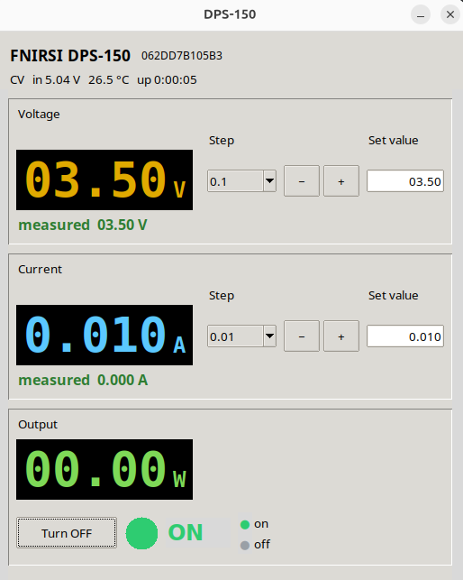

# DPS-150 controll application



## Requirements

- Linux (tested), a USB connection to the DPS-150.
- Membership in the `dialout` group (or the group owning the serial `tty`
  node) so your user can open `/dev/ttyACM*` / `/dev/ttyDSP-150` — see
  **Getting started → step 1** below.
- Python **3.12** with `pyserial` and `pyserial-asyncio` (see `requirements.txt`):

  ```bash
  python -m pip install -r requirements.txt
  ```

`pyserial-asyncio` is required by `dps150.py` and the `set_*` tools;
`scan4device.py` only needs `pyserial`. On this machine the interpreter that
has both is:

## Getting started

1. Detect the supply and record its port:

   ```bash
   python scan4device.py           # detects, prints, updates config.py
   python scan4device.py --dry-run # print only
   ```
   for `/dev/ttyDSP150` use
   ```bash
   #  Ubuntu
   sudo nano /etc/udev/rules.d/99-dsp150.rules
   # add below content inside
   SUBSYSTEM=="tty", ATTRS{idVendor}=="2e3c", ATTRS{idProduct}=="5740", SYMLINK+="ttyDSP-150"
   # and run
   sudo udevadm control --reload-rules
   sudo udevadm trigger

   ```

   The device is the USB device `2e3c:5740` ("Artery AT32 Virtual Com Port").
   The scanner prefers a stable friendly symlink (e.g. `/dev/ttyDSP-150`) over
   the raw `/dev/ttyACM*` node, so the path survives replugging.

   Your user must be allowed to open the serial device. If opening the port
   fails with `Permission denied`, add yourself to the group that owns the
   `tty` nodes (usually `dialout`) and log out and back in (or reboot) so the
   new group membership takes effect:

   ```bash
   sudo usermod -aG dialout "$USER"
   # verify after re-login:
   groups | grep dialout
   ```

   On distributions that use `uucp` or `tty` instead of `dialout`, use that
   group name. A quick way to see which group applies to your device:

   ```bash
   ls -l /dev/ttyACM* /dev/ttyDSP-150
   ```

2. Set a voltage or current interactively (port comes from `config.py`):

   ```bash
   python set_volts.py
   python set_amps.py
   ```

   Each asks for a plain number such as `12` or `3.5`, rejects anything else
   before talking to the device, then writes the setpoint.

3. Turn the output on or off:

   ```bash
   python set_on.py
   python set_off.py
   ```

4. Launch the graphical control panel (needs a display; `tkinter` ships with Python):

   ```bash
   python app.py
   ```

   Use the **Lock** button in the header to prevent accidental changes. While
   locked, the voltage/current setpoints and the output on/off button are
   disabled. Closing the window unlocks first, then turns the output off as
   before.

5. Optional desktop launcher.

   `run-dps150.sh` starts the GUI with the project's virtualenv, switches to
   the project directory first, and appends errors/output to
   `${XDG_STATE_HOME:-$HOME/.local/state}/dps150-app.log`. Run it directly:

   ```bash
   ./run-dps150.sh
   ```

   The script expects the environment created by `make venv`; if
   `venv/bin/python` is missing it shows an error (via `zenity` when available)
   and exits.

   `dps150.desktop` is a Linux desktop entry that launches that script from the
   application menu, using `dps-150-app.png` as its icon. Its `Exec`, `Path`,
   and `Icon` values are absolute paths for this checkout, so update them if
   you move the project. Install it for the current user with:

   ```bash
   mkdir -p ~/.local/share/applications
   cp dps150.desktop ~/.local/share/applications/
   update-desktop-database ~/.local/share/applications
   ```

   The launcher then appears in the desktop application menu as
   **FNIRSI DPS-150**. You can also double-click `dps150.desktop` in a file
   manager that supports desktop entries.


## Files

| File | Purpose |
| --- | --- |
| `dps150.py` | The driver. Dedicated async API over `pyserial-asyncio`. |
| `scan4device.py` | Detect the supply, show all serial ports, write `PORT` into `config.py`. |
| `set_volts.py` | Interactive prompt: ask for a voltage, validate it, send it to the device. |
| `set_amps.py` | Interactive prompt: ask for a current, validate it, send it to the device. |
| `set_on.py` | Turn the output on. |
| `set_off.py` | Turn the output off. |
| `app.py` | Tkinter GUI: live V/A readouts, step +/- and typed entry, output on/off with a colored indicator, and a lock button that disables all changes. |
| `run-dps150.sh` | GUI launcher: uses `venv/bin/python`, changes to the project directory, and logs output to `${XDG_STATE_HOME:-$HOME/.local/state}/dps150-app.log`. |
| `dps150.desktop` | Linux desktop-menu entry that starts `run-dps150.sh` with the project icon. |
| `config.py` | Single line: the serial port to use (e.g. `PORT = "/dev/ttyDSP-150"`). |


## Important: enable Metering in the device menu

The DPS-150 has a **Metering** setting in its on-device system settings.
If it is set to **Close**, the device does not publish/refresh the measured
output voltage and current, so:

- the **device screen appears not to react at all** — setpoints and output
  change over USB, but the displayed measurements stay put;
- the value looks "frozen" and it seems like only on/off works.

Set **Metering → Open** in the system settings. The screen then updates
normally and live measurements are reported.

This is a device-side setting, not something the driver sends; do it once from
the front panel before using the supply via USB.

> Related behavior from the manual: the front panel **locks automatically
> while connected to PC software**, and USB setpoints only take effect while
> the panel is locked. The driver requests the locking session on connect
> (`F1 C1 00 01 01 02`), the same handshake the official software uses.
> No menu change is required after disconnecting USB — the lock releases on
> its own.

## Protocol summary

```
packet:   [header, command, type, length, data..., checksum]
checksum: (type + length + sum(data)) % 256
```

- Outgoing header `0xF1`, incoming header `0xF0`.
- Floats are little-endian IEEE-754 (`"<f"`).
- Commands: `0xA1` GET, `0xB0` baud, `0xB1` SET, `0xC1` session.
- Type `255` is the full 139-byte state snapshot.
- The device also streams telemetry (types 192/195/196/226/227, etc.).

Serial settings: `115200 8N1`, RTS/CTS enabled.

## Driver API (async)

`dsp150.py` async Python driver and tooling for the **FNIRSI DPS-150**
programmable DC power supply (0–30 V, 0–5 A, 150 W).


```python
import asyncio
from dps150 import DPS150

async def main():
    async with DPS150() as psu:            # opens port + handshake
        info = await psu.get_info()        # model / hardware / firmware
        state = await psu.refresh()        # full 139-byte snapshot
        await psu.set_voltage(5.0, verify=True)
        await psu.set_current(0.5, verify=True)
        await psu.set_output(True, verify=True)
        await asyncio.sleep(2)
        state = await psu.refresh()
        print(state.output_voltage, state.output_current, state.mode)
        await psu.set_output(False)

asyncio.run(main())
```

Other methods: `set_ovp`, `set_ocp`, `set_opp`, `set_otp`, `set_lvp`,
`set_brightness`, `set_volume`, `set_metering`, `set_group`, `load_group`,
`monitor`, and the `on_state` callback.

## License / attribution

Protocol research by cho45 (MIT). This implementation is an independent
driver built on that public protocol description.

##  Acknowledgments


The wire protocol was reverse-engineered by
[cho45/fnirsi-dps-150](https://github.com/cho45/fnirsi-dps-150) and is
documented at
<https://deepwiki.com/cho45/fnirsi-dps-150/4.1-communication-protocol>.
